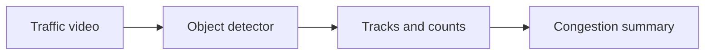
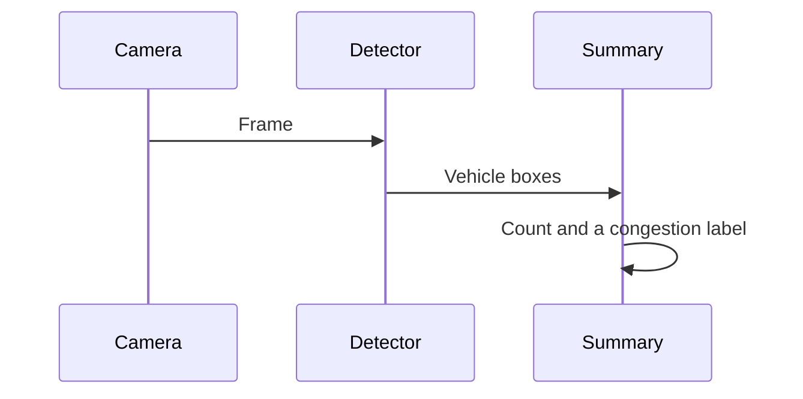

# Smart traffic monitor

Count vehicles in a road video and summarize how the flow is changing. Cities that do not have a loop detector every block still have cameras. This project treats the camera as the sensor.



## What gets measured

A detector (YOLO-style) proposes vehicles in each frame. Counts over time become a simple congestion read: rising count and falling speed-through-the-frame means the block is loading up. The output is a time series and a short status, not a full traffic-management system.



## Run it

```bash
python -m venv .venv && source .venv/bin/activate
pip install -r requirements.txt
```

Point the script at a video file. The first run downloads detector weights if they are not cached. CPU works for a short clip. A GPU is the difference between a demo and a live stream.

## What this signals

Video analytics with a civic use: turn a camera you already have into a count, and keep the model choice boring and inspectable.
